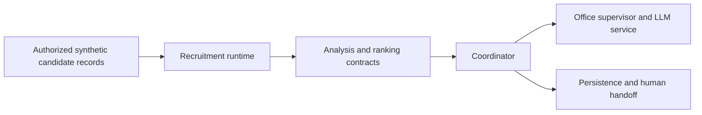

# Recruitment Workflow Components

**A consolidated engineering reference for recruitment ingestion, candidate-analysis contracts, ranking, orchestration and shared assistant services.**

The local work contains overlapping recruitment and office-assistant implementations. A single candidate repository makes those boundaries visible instead of multiplying nearly identical portfolio entries. It preserves the individual runtime components and their schemas while identifying where a unified integration still needs to be demonstrated.

## Architecture and data flow



## Implementation decisions

1. Recruitment ingestion, coordinating code, office services and candidate ranking remain separate components with their own dependencies. Consolidation is repository organization, not proof of a single validated production deployment.

2. Pydantic request/response types make candidate and ranking contracts inspectable. Tests validate those contracts using fictional profiles rather than real resumes.

3. The existing sort_by_ai_score function orders previously supplied scores. It neither trains a learning-to-rank model nor produces independent candidate-quality labels.

4. The coordinator and supervisor boundaries expose where workflow status, persistence and handoff need integration tests. A completion message must not be treated as proof that an external action occurred.

5. Recruitment-source access and OAuth configuration are integration concerns. Account-debug helpers, real exports, resumes, tokens and organization-specific runtime settings are excluded from the prepared source copy.

6. Independent component environments are preserved. Installing every requirements file into one environment would not establish compatibility and can conceal conflicting runtime assumptions.

## Source navigation

| Module | Responsibility |
| --- | --- |
| `components/recruitment_runtime` | Recruitment runtime and source adapters |
| `components/master_agent` | Coordination modules |
| `components/office_services` | Database, supervisor and shared LLM service |
| `components/candidate_ranking` | Candidate-analysis schemas and ranking service |
| `components/config` | Workflow-context configuration boundary |

## Reproducible component checks

The minimal checks use Python 3.11/3.12 and `requirements-checks.txt`. They are independent of live accounts, paid APIs and GPU inference. They exercise the specific boundary described below; they are not a measurement of the complete application's model quality.

Linux/macOS, from the repository root:

```bash
python3.11 -m venv .venv
.venv/bin/python -m pip install -r requirements-checks.txt
.venv/bin/python offline_demo.py
.venv/bin/python -m unittest discover -s tests/offline -v
.venv/bin/python scripts/check_source.py
```

Windows PowerShell, from the repository root:

```powershell
py -3.11 -m venv .venv
& ./.venv/Scripts/python.exe -m pip install -r requirements-checks.txt
& ./.venv/Scripts/python.exe offline_demo.py
& ./.venv/Scripts/python.exe -m unittest discover -s tests/offline -v
& ./.venv/Scripts/python.exe scripts/check_source.py
```

### What the replay actually verifies

Actual Candidate/RankingRequest schemas validate three fictional profiles. The existing ranking function returns the order demo-2, demo-1, demo-3 from fixture-provided scores. No real recruitment API is called, no model creates a suitability score, and no hiring decision is evaluated.

The recorded example output is in [docs/offline-demo-output.json](docs/offline-demo-output.json). CI checks the minimal suite separately from a Gitleaks secret scan. Source compilation verifies syntax; it does not instantiate every runtime integration.

## Full runtime and configuration

Use separate virtual environments or containers for the component requirements. Recruitment and candidate-ranking components have their own Docker Compose files. Office services have separate Compose configurations under central_database, supervisor_service and unified_llm_service. Coordinator modules import as `master_agent` with `PYTHONPATH=components`. A root-level unified production Compose deployment is not asserted.

Runtime dependencies and configuration notes are documented in [docs/runtime.md](docs/runtime.md). Minimal and full-runtime environments are intentionally separate. Filled local settings, credentials, production exports and original Git history are outside the source export. Configuration examples describe shape and environment references; they are not a working customer account.

## Evaluation protocol

An engineering integration study should first verify schema alignment, idempotency, persistence, retries and real tool invocation. A separate authorized ranking study needs independent relevance labels, task-appropriate baselines, ranking metrics and error analysis. The current fixture ordering cannot establish fairness, relevance or model quality.

## Current boundaries

- The components are not presented as a newly trained ranking model.
- A complete cross-component workflow remains an integration validation task.
- Only synthetic candidate data is appropriate for the included demonstration.

This repository presents the reviewed, anonymized source and the reproducible component checks described above. Private account configuration, customer identities, production documents, recordings and original deployment settings are excluded. Full application-level evaluation remains separate from the offline checks.

## Provenance and dependencies

The source export belongs to the author's local project family; technical component boundaries are recorded in [docs/source-provenance.json](docs/source-provenance.json). Third-party libraries, pretrained models and adapters retain their own licenses and attribution; see [THIRD_PARTY.md](THIRD_PARTY.md). No new permissive license is assigned by this documentation update.


The public organization context is fictional and contains no salary ranges, real staff, client SLA, or active workflow automation. Organization and workflow files are runtime configuration even though they are YAML rather than `.env`. Replace them only with a private, approved configuration when deploying.
