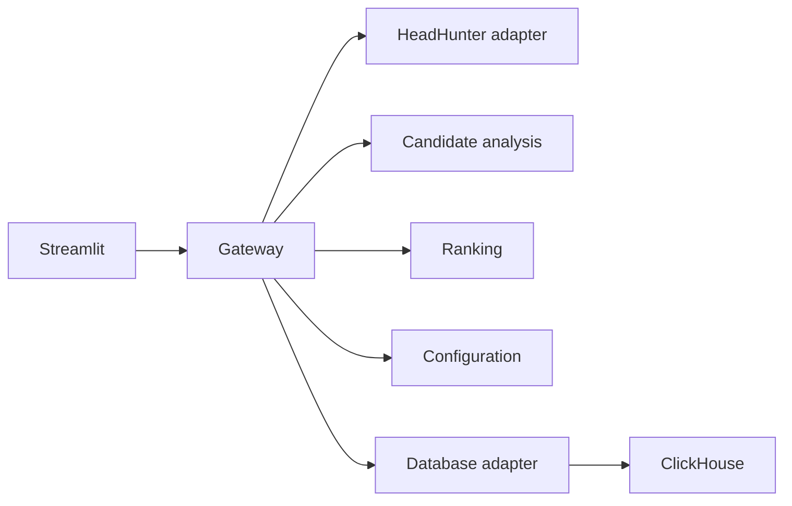

# Candidate Analysis and Ranking Services

A service-oriented recruitment application with a FastAPI gateway, HeadHunter adapter, candidate-analysis workers, ranking, ClickHouse persistence and a Streamlit interface. This component is part of the consolidated [Recruitment Workflow Components](../../README.md) repository.

The implementation separates source access from analysis and ranking. It can expose candidate-search results, request specialist analysis, retain structured reports and order candidates using supplied scores. The published demonstration uses fictional profiles; it does not contact a recruitment account or make employment decisions.

## Architecture



| Service | Configured host port | Source entry point |
| --- | --- | --- |
| Gateway | 8088 | `gateway/main.py` |
| Ranking | 8002 | `ranking/main.py` |
| HeadHunter adapter | 8003 | `hh_api/main.py` |
| Configuration | 8004 | `config/main.py` |
| Candidate analysis | 8005 | `ai_analysis/main.py` |
| Database API | 8006 | `database/main.py` |
| Streamlit | 8501 | `frontend/app.py` |
| ClickHouse | 8123 HTTP; 9000 native | `docker-compose.yml` |

The gateway address is `http://localhost:8088`, as configured in Compose. Run this component separately from the recruitment runtime, which uses overlapping host ports. They are alternative component deployments, not two Compose stacks that can automatically share every port and volume.

## Candidate processing and analysis

`shared/models.py` defines the Pydantic request/response contracts. `shared/utils.py` contains shared integration helpers. Candidate analysis is separated into `ai_analysis/main.py`, specialist-agent definitions, prompt configuration and coordinator logic. The configured provider/model is a runtime setting, not a fixed assertion about a current provider product.

The specialist prompts cover technical skills, experience relevance, resume structure, growth-related questions, inconsistencies and organizational context. Coordinator output should remain traceable to the input resume and vacancy. These outputs are model-generated assessments, not established facts about a person. The public source contains no independent validation that these prompts predict job performance or provide unbiased rankings.

The ranking implementation orders the scores present in the request. The offline replay verifies the order of deliberately assigned fixture scores. An earlier description mentioned a RandomForest/TF-IDF weight optimizer; no corresponding fit routine or RandomForest implementation is included in this component, so that description is not presented as an implemented ML result. There is no claimed learning-to-rank benchmark in this release.

## Configuration and local setup

Use the repository-level configuration preparation command before editing ignored runtime settings:

```bash
python scripts/prepare_config.py
```

Review `config/settings.example.yaml` and the environment-variable names in `.env.example`. Required credentials are supplied by the operator; no live keys are preconfigured. JSON/YAML environment references are resolved by the application's loaders, including typed numeric references where supported. A `.env` file is not automatically read by every standalone Python command; export values in the process environment or use an entry point that explicitly loads it.

From this component directory, validate Compose before starting the optional live stack:

```bash
docker compose config --quiet
docker compose up -d --build
docker compose ps
docker compose logs --tail=50 gateway ai_analysis ranking
```

This starts containers and may connect to configured external services. It is separate from the root offline demo. HeadHunter access requires an authorized application/account and appropriate OAuth access. Provider billing, API limits and endpoint availability depend on the operator's configuration. Account-specific token-dump helpers and real resume exports are excluded.

For Python development, use a component-specific environment rather than installing all consolidated components together:

```bash
python -m venv .venv
.venv/bin/python -m pip install -r requirements.txt
```

On Windows, use `./.venv/Scripts/python.exe` for the same commands. Dependencies and entry points are retained in the component requirements and Compose file; the root minimal environment is for offline contract checks only.

## Diagnostics and failure handling

Check the source adapter and gateway independently before interpreting a missing candidate list as an analysis failure. Authentication errors, source rate limiting, schema mismatch, an unavailable worker and an empty search result are different states. Retries must respect the external API's rate limits rather than repeatedly submitting the same failed request.

```bash
curl --fail http://localhost:8003/health
docker compose logs --tail=100 hh_api gateway
docker compose logs --tail=100 ai_analysis database
```

Inspect error types and status codes without printing tokens, full authorization headers or real resumes. Check ClickHouse initialization and database selection against `config/clickhouse` and Compose. Do not substitute a production database while diagnosing the demonstration.

Search/analysis latency depends on source response times, provider calls, configured concurrency and input size. The older guide's throughput, cost and speedup figures are not retained as measured results because no reproducible benchmark accompanies them. Measure token usage and end-to-end latency on the actual configured provider before making an operational claim.

## Reproducibility and model evaluation

Run the repository's synthetic replay and contract suite from the repository root:

```bash
.venv/bin/python offline_demo.py
.venv/bin/python -m unittest discover -s tests/offline -v
```

The replay validates `Candidate`/`RankingRequest` schemas and the existing sorting function against three fictional candidates. Scores are fixture inputs. No provider generates those scores, and no real candidate is evaluated.

An application evaluation needs an approved resume/vacancy corpus, independent relevance labels, fixed splits that keep the same candidate out of train/test overlap, simple ranking baselines and task-appropriate ranking metrics. Extraction quality, unsupported assertions, missing fields and source failures should be measured separately from final ordering. The repository contains no claim of fair hiring outcomes, production uplift or trained-model superiority.

## Source navigation and additional guides

- `gateway`, `hh_api`, `ai_analysis`, `ranking`, `database` and `config` expose the service boundaries.
- `frontend/app.py` provides the Streamlit client.
- `QUICK_START.md`, `INSTALL.md`, `AI_SETUP.md` and `ENVIRONMENT_VARIABLES.md` preserve further implementation notes; prefer the current source and neutralized settings when a historical instruction differs.
- The root README documents component consolidation, source provenance, validation scope and third-party attribution.

There is no component LICENSE file accompanying the former MIT badge. This update does not assign a new permissive license or replace third-party dependency terms.

## Implemented HTTP route index

The following index is extracted from constant-path decorators in this source snapshot. Gateway forwarding and runtime router prefixes should be checked in the corresponding entry point.

| Source | Method | Declared route | Handler |
| --- | --- | --- | --- |
| `ai_analysis/main.py` | GET | `/health` | `health_check` |
| `ai_analysis/main.py` | POST | `/analyze` | `analyze_candidate` |
| `ai_analysis/main.py` | POST | `/analyze/batch` | `analyze_candidates_batch` |
| `ai_analysis/main.py` | GET | `/config` | `get_ai_config` |
| `ai_analysis/main.py` | POST | `/settings/auth` | `update_auth_settings` |
| `ai_analysis/main.py` | POST | `/multi-agent/analyze` | `analyze_candidate_multi_agent` |
| `ai_analysis/main.py` | GET | `/multi-agent/agents` | `get_available_agents` |
| `ai_analysis/main.py` | GET | `/multi-agent/health` | `multi_agent_health_check` |
| `ai_analysis/main.py` | POST | `/multi-agent/batch` | `analyze_candidates_batch_multi_agent` |
| `config/main.py` | GET | `/health` | `health_check` |
| `config/main.py` | GET | `/config` | `get_config` |
| `config/main.py` | GET | `/config/{section}` | `get_config_section` |
| `config/main.py` | PUT | `/config/{section}` | `update_config_section` |
| `config/main.py` | GET | `/services` | `get_services_config` |
| `config/main.py` | GET | `/services/{service_name}` | `get_service_config` |
| `config/main.py` | GET | `/hh-api` | `get_hh_api_config` |
| `database/main.py` | GET | `/health` | `health_check` |
| `database/main.py` | POST | `/candidates` | `save_candidate` |
| `database/main.py` | GET | `/candidates/{candidate_id}` | `get_candidate` |
| `database/main.py` | POST | `/candidates/search` | `search_candidates` |
| `database/main.py` | GET | `/candidates/top/{limit}` | `get_top_candidates` |
| `database/main.py` | PUT | `/candidates/{candidate_id}/search` | `update_search_count` |
| `database/main.py` | GET | `/statistics` | `get_statistics` |
| `gateway/main.py` | GET | `/ping` | `ping` |
| `gateway/main.py` | GET | `/health` | `health_check` |
| `gateway/main.py` | GET | `/health/services` | `get_services_health` |
| `gateway/main.py` | GET | `/config` | `get_config` |
| `gateway/main.py` | GET | `/config/{section}` | `get_config_section` |
| `gateway/main.py` | GET | `/filters` | `get_search_filters` |
| `gateway/main.py` | GET | `/search` | `search_candidates` |
| `gateway/main.py` | GET | `/candidates/{candidate_id}` | `get_candidate_details` |
| `gateway/main.py` | POST | `/top-candidates` | `get_top_candidates` |
| `gateway/main.py` | GET | `/areas` | `get_areas` |
| `gateway/main.py` | GET | `/professional-roles` | `get_professional_roles` |
| `gateway/main.py` | GET | `/languages` | `get_languages` |
| `gateway/main.py` | GET | `/dictionaries` | `get_dictionaries` |
| `gateway/main.py` | GET | `/oauth/authorize-url` | `get_authorize_url` |
| `gateway/main.py` | POST | `/oauth/token` | `exchange_code_for_token` |
| `gateway/main.py` | POST | `/oauth/refresh` | `refresh_token` |
| `gateway/main.py` | POST | `/settings/auth` | `update_auth_settings` |
| `gateway/main.py` | GET | `/ranking/weights` | `get_ranking_weights` |
| `gateway/main.py` | PUT | `/ranking/weights` | `update_ranking_weights` |
| `gateway/main.py` | GET | `/database/statistics` | `get_database_statistics` |
| `gateway/main.py` | POST | `/database/candidates` | `create_candidate` |
| `gateway/main.py` | GET | `/database/candidates/{candidate_id}` | `get_candidate_from_db` |
| `gateway/main.py` | PUT | `/database/candidates/{candidate_id}/searched` | `update_candidate_search_count` |
| `gateway/main.py` | POST | `/ranking/calculate-scores` | `calculate_scores` |
| `gateway/main.py` | POST | `/vacancy/top` | `build_vacancy_top` |
| `gateway/main.py` | POST | `/vacancy/details` | `vacancy_details` |
| `hh_api/main.py` | GET | `/health` | `health_check` |
| `hh_api/main.py` | GET | `/areas` | `get_areas` |
| `hh_api/main.py` | GET | `/professional-roles` | `get_professional_roles` |
| `hh_api/main.py` | GET | `/languages` | `get_languages` |
| `hh_api/main.py` | GET | `/dictionaries` | `get_dictionaries` |
| `hh_api/main.py` | POST | `/vacancy/details` | `get_vacancy_details_endpoint` |
| `hh_api/main.py` | POST | `/vacancy/responses` | `get_vacancy_responses_endpoint` |
| `hh_api/main.py` | GET | `/search` | `search_resumes` |
| `hh_api/main.py` | GET | `/resume/{resume_id}` | `get_resume_details` |
| `hh_api/main.py` | GET | `/oauth/authorize-url` | `get_authorize_url` |
| `hh_api/main.py` | POST | `/oauth/token` | `exchange_code_for_token` |
| `hh_api/main.py` | POST | `/oauth/refresh` | `refresh_token` |
| `hh_api/main.py` | POST | `/settings/auth` | `update_auth_settings` |
| `ranking/main.py` | GET | `/health` | `health_check` |
| `ranking/main.py` | POST | `/rank` | `rank_candidates` |
| `ranking/main.py` | GET | `/weights` | `get_weights` |
| `ranking/main.py` | PUT | `/weights` | `update_weights` |
| `ranking/main.py` | POST | `/calculate-scores` | `calculate_scores` |
| `search/main.py` | GET | `/ping` | `ping` |
| `search/main.py` | GET | `/health` | `health_check` |
| `search/main.py` | GET | `/filters` | `get_filters` |
| `search/main.py` | GET | `/dictionaries` | `get_dictionaries` |
| `search/main.py` | POST | `/vacancy/top` | `build_vacancy_top` |
| `search/main.py` | GET | `/search` | `search` |
