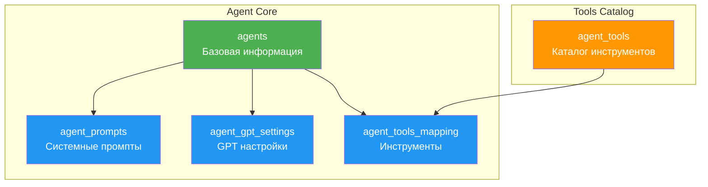
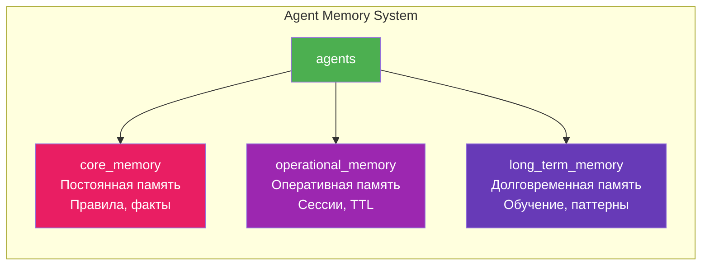
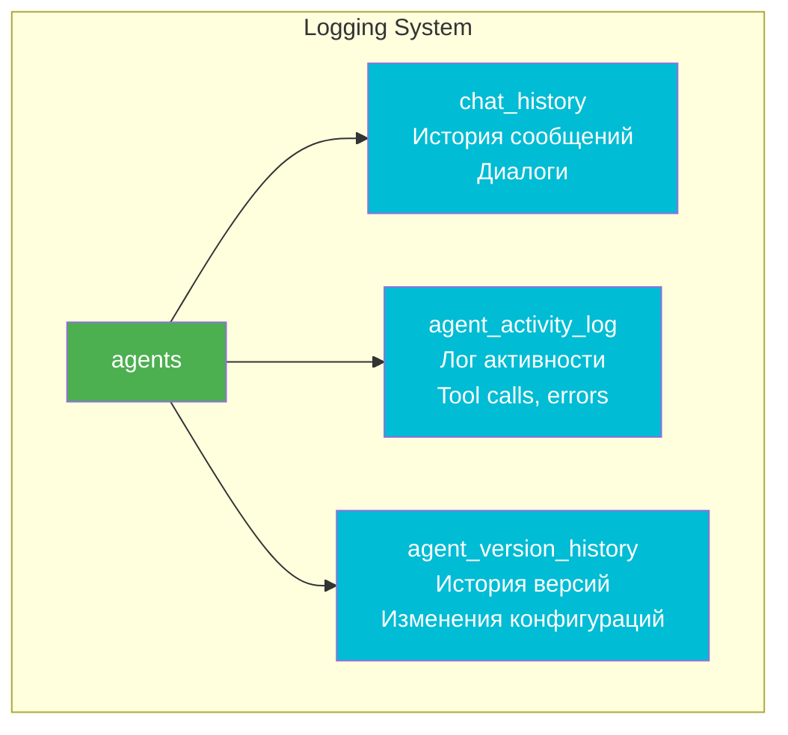
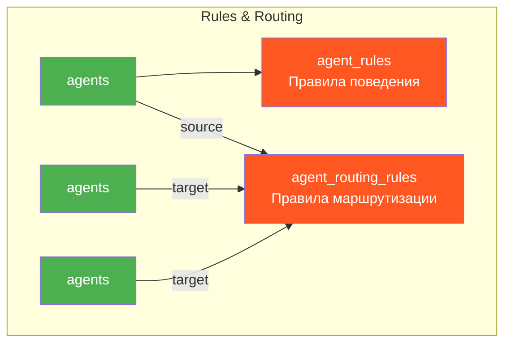
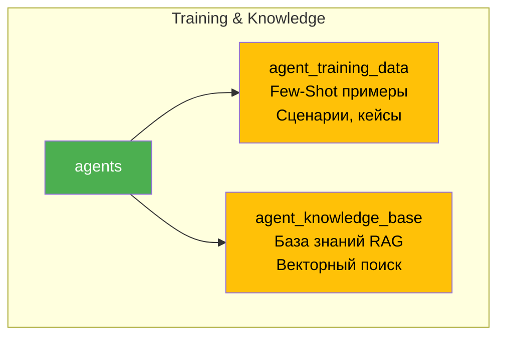
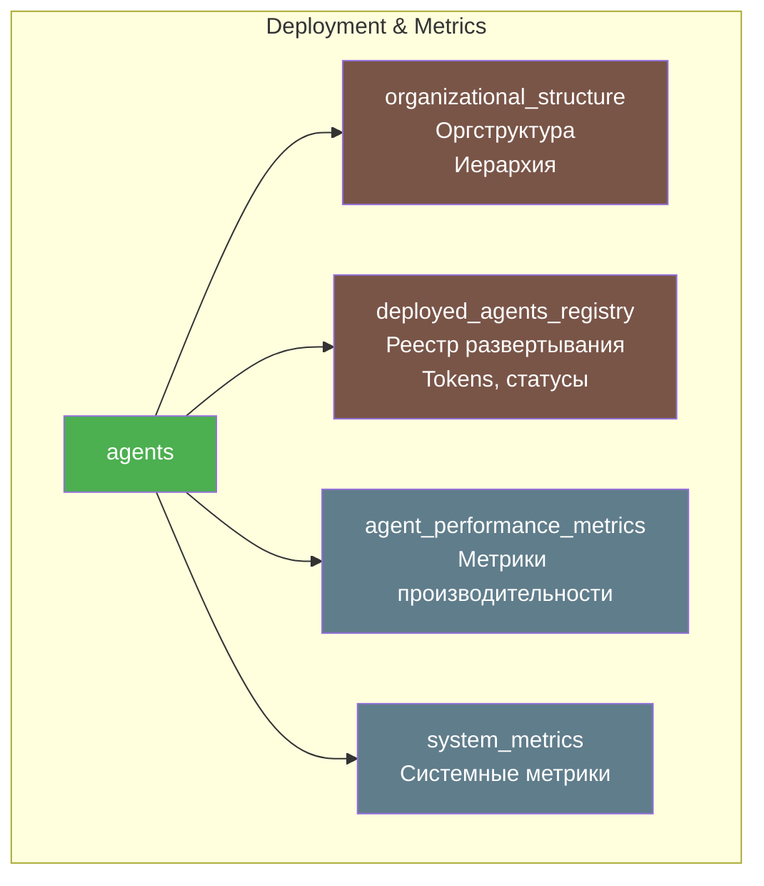
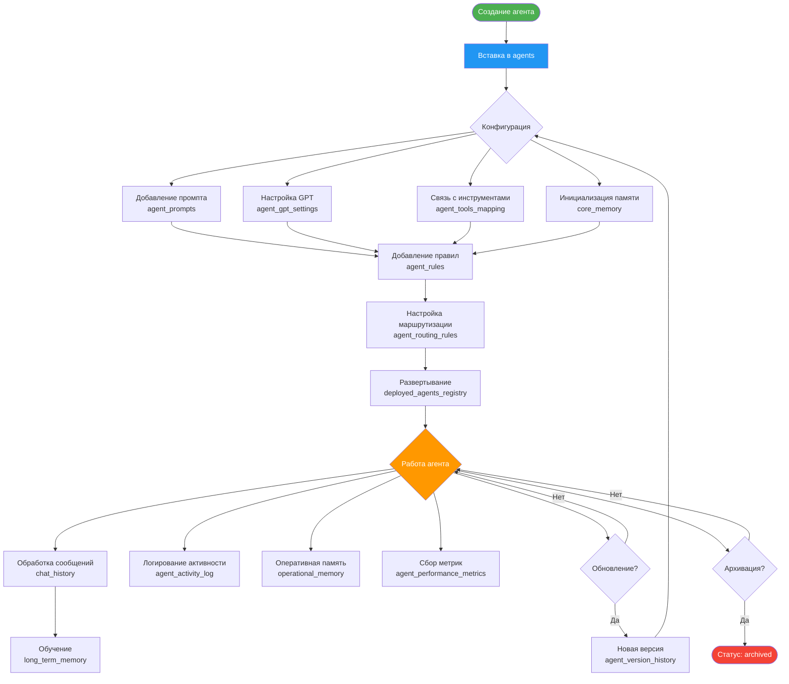
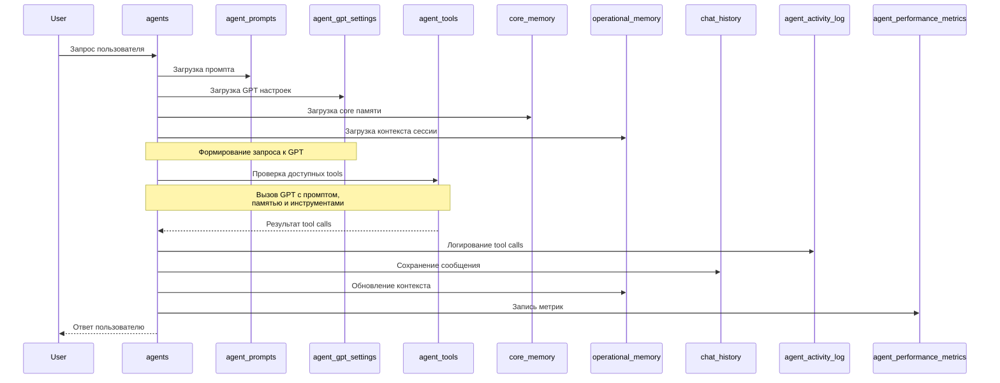
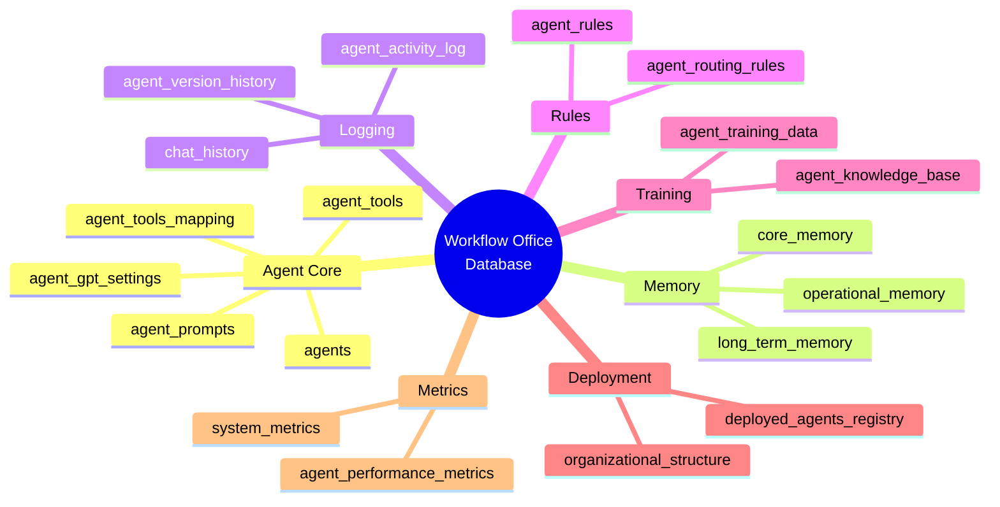

# 🗂️ Workflow Office - Диаграммы Базы Данных

## 📊 Entity Relationship Diagram (ERD)

### Полная схема базы данных

```mermaid
erDiagram
    %% ============================================
    %% ОСНОВНЫЕ ТАБЛИЦЫ АГЕНТОВ
    %% ============================================
    
    agents {
        VARCHAR agent_id PK "Уникальный ID агента"
        VARCHAR agent_name "Отображаемое имя"
        VARCHAR agent_type "Тип агента"
        VARCHAR display_name "Человеческое имя"
        VARCHAR role "Роль агента"
        TEXT persona "Описание личности"
        VARCHAR telegram_username UK "Telegram username"
        VARCHAR teams_identity UK "Teams identity"
        ENUM status "active/inactive/maintenance"
        VARCHAR version "Версия конфигурации"
        BOOLEAN is_active "Активен ли"
        TIMESTAMP created_at
        TIMESTAMP updated_at
        JSON metadata "Метаданные"
    }
    
    agent_prompts {
        VARCHAR prompt_id PK "ID промпта"
        VARCHAR agent_id FK "ID агента"
        TEXT system_prompt "Системный промпт"
        TEXT tone_of_voice "Тон общения"
        VARCHAR version "Версия промпта"
        BOOLEAN is_current "Текущая версия"
        TEXT additional_instructions
        JSON examples "Few-Shot примеры"
        TIMESTAMP created_at
        TEXT changelog "Описание изменений"
    }
    
    agent_gpt_settings {
        VARCHAR setting_id PK "ID настройки"
        VARCHAR agent_id FK UK "ID агента"
        VARCHAR model "gpt-5-nano/gpt-5"
        ENUM reasoning_effort "minimal/low/medium/high"
        DECIMAL temperature "Temperature для GPT-4"
        INTEGER max_tokens "Макс токенов"
        VARCHAR tool_choice "auto/required/none"
        BOOLEAN parallel_tool_calls
        BOOLEAN prompt_cache_enabled
        VARCHAR prompt_cache_key
        BOOLEAN use_responses_api
        INTEGER rate_limit_per_minute
    }
    
    agent_tools {
        VARCHAR tool_id PK "ID инструмента"
        VARCHAR tool_name UK "Название инструмента"
        ENUM tool_type "function/mcp/api/database"
        TEXT description "Описание для GPT"
        VARCHAR category "Категория"
        JSON parameters "JSON схема параметров"
        VARCHAR mcp_server_url "URL MCP сервера"
        VARCHAR api_endpoint "API endpoint"
        BOOLEAN is_active
    }
    
    agent_tools_mapping {
        VARCHAR mapping_id PK "ID связи"
        VARCHAR agent_id FK "ID агента"
        VARCHAR tool_id FK "ID инструмента"
        BOOLEAN is_enabled "Включен ли"
        INTEGER priority "Приоритет (0-высший)"
        INTEGER rate_limit_per_hour
        JSON custom_params
    }
    
    %% ============================================
    %% ПАМЯТЬ АГЕНТОВ
    %% ============================================
    
    core_memory {
        VARCHAR memory_id PK "ID записи памяти"
        VARCHAR agent_id FK "ID агента"
        ENUM memory_type "rule/fact/persona/constraint"
        VARCHAR memory_category
        VARCHAR memory_key "Ключ памяти"
        TEXT memory_value "Значение"
        INTEGER priority "Приоритет 1-10"
        BOOLEAN is_permanent "Постоянная память"
        BOOLEAN is_active
        JSON applies_to_context
        JSON tags
    }
    
    operational_memory {
        VARCHAR operation_id PK "ID операции"
        VARCHAR agent_id FK "ID агента"
        VARCHAR session_id "ID сессии"
        VARCHAR user_id "ID пользователя"
        VARCHAR task_type "Тип задачи"
        TEXT task_context "Контекст"
        TEXT current_focus "Текущий фокус"
        JSON session_data
        TIMESTAMP expires_at "TTL"
        TIMESTAMP created_at
    }
    
    long_term_memory {
        VARCHAR ltm_id PK "ID записи"
        VARCHAR agent_id FK "ID агента"
        ENUM memory_type "learned_pattern/user_preference"
        VARCHAR title
        TEXT content
        JSON context_tags
        INTEGER usage_count "Количество применений"
        DECIMAL success_rate "Процент успеха"
        TIMESTAMP last_used_at
        BOOLEAN is_active
    }
    
    %% ============================================
    %% ИСТОРИЯ И ЛОГИРОВАНИЕ
    %% ============================================
    
    chat_history {
        VARCHAR message_id PK "ID сообщения"
        VARCHAR agent_id FK "ID агента"
        VARCHAR session_id "ID сессии"
        VARCHAR user_id "ID пользователя"
        ENUM role "user/assistant/system/tool"
        TEXT content "Содержимое"
        ENUM content_type "text/image/tool_call"
        JSON tool_calls "Вызовы инструментов"
        ENUM platform "telegram/teams/slack"
        INTEGER tokens_used
        INTEGER response_time_ms
        TIMESTAMP timestamp
    }
    
    agent_activity_log {
        VARCHAR log_id PK "ID лога"
        VARCHAR agent_id FK "ID агента"
        ENUM activity_type "message/tool_call/error"
        VARCHAR activity_name
        TEXT description
        JSON details
        ENUM status "success/failure/partial"
        TEXT error_message
        INTEGER duration_ms
        TIMESTAMP timestamp
    }
    
    agent_version_history {
        VARCHAR history_id PK "ID истории"
        VARCHAR agent_id FK "ID агента"
        VARCHAR version "Версия"
        VARCHAR previous_version
        ENUM change_type "prompt/settings/tools"
        TEXT changelog
        JSON config_snapshot_before
        JSON config_snapshot_after
        VARCHAR changed_by
        BOOLEAN is_rollback
        TIMESTAMP changed_at
    }
    
    %% ============================================
    %% ПРАВИЛА И КОНФИГУРАЦИИ
    %% ============================================
    
    agent_rules {
        VARCHAR rule_id PK "ID правила"
        VARCHAR agent_id FK "ID агента"
        ENUM rule_type "communication/behavior/security"
        VARCHAR rule_name
        TEXT rule_content
        JSON applies_when
        INTEGER priority
        BOOLEAN is_active
        BOOLEAN is_overridable
    }
    
    agent_routing_rules {
        VARCHAR routing_id PK "ID правила"
        VARCHAR source_agent_id FK "Агент-источник"
        VARCHAR target_agent_id FK "Агент-получатель"
        ENUM routing_type "delegation/escalation/report"
        TEXT routing_condition
        BOOLEAN is_bidirectional
        INTEGER priority
        BOOLEAN is_active
    }
    
    %% ============================================
    %% ОБУЧАЮЩИЕ ДАННЫЕ
    %% ============================================
    
    agent_training_data {
        VARCHAR training_id PK "ID обучающих данных"
        VARCHAR agent_id FK "ID агента"
        ENUM data_type "example/knowledge_base/faq"
        VARCHAR category
        VARCHAR title
        TEXT content
        TEXT input_example
        TEXT output_example
        JSON tags
        INTEGER priority
        BOOLEAN is_active
    }
    
    agent_knowledge_base {
        VARCHAR knowledge_id PK "ID знаний"
        VARCHAR agent_id FK "ID агента (NULL для общих)"
        VARCHAR title
        TEXT content
        VARCHAR source
        VARCHAR category
        JSON tags
        JSON embedding_vector "Для RAG"
        INTEGER access_count
        TIMESTAMP last_accessed_at
        BOOLEAN is_active
        BOOLEAN is_verified
    }
    
    %% ============================================
    %% ОРГАНИЗАЦИЯ И РАЗВЕРТЫВАНИЕ
    %% ============================================
    
    organizational_structure {
        VARCHAR id PK "ID записи"
        VARCHAR department "Отдел"
        VARCHAR division "Подразделение"
        VARCHAR position "Должность"
        VARCHAR full_name "ФИО"
        INTEGER hierarchy_level "Уровень иерархии"
        VARCHAR manager_id FK "ID менеджера"
        VARCHAR agent_id FK "ID агента"
        ENUM employment_type "full_time/ai_agent"
        BOOLEAN is_active
    }
    
    deployed_agents_registry {
        VARCHAR deployment_id PK "ID развертывания"
        VARCHAR agent_id FK "ID агента"
        VARCHAR telegram_bot_token
        VARCHAR telegram_username UK
        VARCHAR teams_app_id
        VARCHAR teams_bot_id
        JSON channel_roles
        ENUM deployment_status "deployed/stopped/maintenance"
        TIMESTAMP last_health_check
        JSON limits
        JSON performance_metrics
        TIMESTAMP last_activity
    }
    
    %% ============================================
    %% МЕТРИКИ
    %% ============================================
    
    agent_performance_metrics {
        VARCHAR metric_id PK "ID метрики"
        VARCHAR agent_id FK "ID агента"
        VARCHAR metric_name "Название метрики"
        ENUM metric_type "counter/gauge/histogram"
        DECIMAL metric_value "Значение"
        ENUM period "minute/hour/day/week/month"
        TIMESTAMP period_start
        TIMESTAMP period_end
        JSON dimensions
        TIMESTAMP recorded_at
    }
    
    system_metrics {
        VARCHAR id PK "ID метрики"
        VARCHAR metric_name
        DECIMAL metric_value
        VARCHAR agent_id FK "ID агента (опционально)"
        VARCHAR period
        JSON metadata
        TIMESTAMP timestamp
    }
    
    %% ============================================
    %% СВЯЗИ МЕЖДУ ТАБЛИЦАМИ
    %% ============================================
    
    %% Агенты -> Промпты
    agents ||--o{ agent_prompts : "имеет промпты"
    
    %% Агенты -> GPT настройки
    agents ||--|| agent_gpt_settings : "имеет настройки"
    
    %% Агенты -> Инструменты (через mapping)
    agents ||--o{ agent_tools_mapping : "использует"
    agent_tools ||--o{ agent_tools_mapping : "доступен для"
    
    %% Агенты -> Память
    agents ||--o{ core_memory : "имеет core память"
    agents ||--o{ operational_memory : "имеет operational память"
    agents ||--o{ long_term_memory : "имеет long-term память"
    
    %% Агенты -> История и логи
    agents ||--o{ chat_history : "имеет историю"
    agents ||--o{ agent_activity_log : "имеет логи"
    agents ||--o{ agent_version_history : "имеет версии"
    
    %% Агенты -> Правила
    agents ||--o{ agent_rules : "имеет правила"
    agents ||--o{ agent_routing_rules : "маршрутизация от"
    agents ||--o{ agent_routing_rules : "маршрутизация к"
    
    %% Агенты -> Обучающие данные
    agents ||--o{ agent_training_data : "имеет обучающие данные"
    agents ||--o{ agent_knowledge_base : "имеет базу знаний"
    
    %% Агенты -> Организация
    agents ||--o| organizational_structure : "представлен в"
    agents ||--o| deployed_agents_registry : "развернут как"
    
    %% Агенты -> Метрики
    agents ||--o{ agent_performance_metrics : "имеет метрики"
    agents ||--o{ system_metrics : "связан с"
    
    %% Оргструктура -> сама себя (иерархия)
    organizational_structure ||--o{ organizational_structure : "подчиняется"
```

---

## 🎯 Архитектура по группам таблиц

### 1. Ядро агента (Agent Core)



### 2. Память агента (Agent Memory)



### 3. История и логирование (Logging & History)



### 4. Правила и маршрутизация (Rules & Routing)



### 5. Обучающие данные (Training & Knowledge)



### 6. Развертывание и метрики (Deployment & Metrics)



---

## 🔄 Жизненный цикл агента



---

## 🌊 Поток данных при обработке запроса



---

## 📦 Группировка таблиц по назначению



---

## 🔗 Связи агентов (маршрутизация)

```mermaid
graph TD
    subgraph "HR Team Routing"
        S[Supervisor<br/>@boss.ai]
        R[Recruiter<br/>@alena.ai]
        SC[Scrinner<br/>@sergei.ai]
        
        S -->|delegation:<br/>поиск кандидатов| R
        S -->|delegation:<br/>скрининг| SC
        R -->|delegation:<br/>детальный скрининг| SC
        R -->|report:<br/>найденные кандидаты| S
        SC -->|report:<br/>результаты скрининга| R
        SC -->|report:<br/>итоговые отчеты| S
    end
    
    style S fill:#4CAF50,color:#fff
    style R fill:#2196F3,color:#fff
    style SC fill:#FF9800,color:#fff
```

---

## 📊 Статистика таблиц

| Категория | Таблиц | Основное назначение |
|-----------|--------|---------------------|
| **Agent Core** | 5 | Базовая информация, промпты, настройки, инструменты |
| **Memory** | 3 | Core, Operational, Long-term память |
| **Logging** | 3 | История чатов, логи активности, версии |
| **Rules** | 2 | Правила поведения и маршрутизации |
| **Training** | 2 | Обучающие данные и база знаний |
| **Deployment** | 2 | Оргструктура и реестр развертывания |
| **Metrics** | 2 | Метрики производительности и системные |
| **ИТОГО** | **19** | Полная экосистема агентов |

---

## 🎨 Цветовая легенда

- 🟢 **Зеленый** - Основные таблицы агентов (agents)
- 🔵 **Синий** - Конфигурация (prompts, settings, tools)
- 🟣 **Фиолетовый** - Память (core, operational, long-term)
- 🔷 **Голубой** - Логирование (history, logs, versions)
- 🔴 **Красный** - Правила (rules, routing)
- 🟡 **Желтый** - Обучение (training, knowledge)
- 🟤 **Коричневый** - Развертывание (org, registry)
- ⚫ **Серый** - Метрики (performance, system)

---

## 🚀 Преимущества архитектуры

### ✅ Нормализация
- Нет дублирования данных
- Легкое обновление компонентов
- Целостность через внешние ключи

### ✅ Масштабируемость
- Независимое хранение компонентов
- Горизонтальное масштабирование
- Оптимизированные индексы

### ✅ Гибкость
- JSON поля для кастомизации
- Модульная архитектура
- Версионность конфигураций

### ✅ Производительность
- Индексы на всех FK и часто используемых полях
- Представления (views) для частых запросов
- TTL для автоочистки временных данных

---

**Автор:** Workflow Office Team  
**Версия:** 2.0.0  
**Дата:** 2025-10-13

