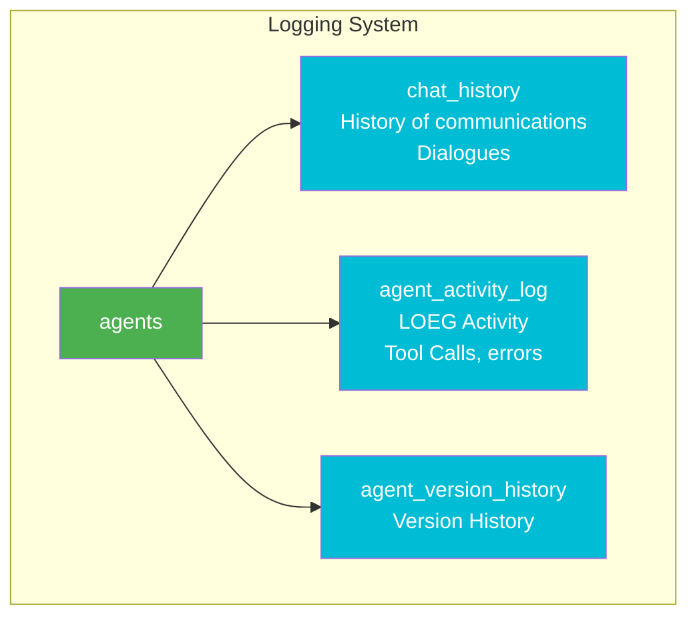
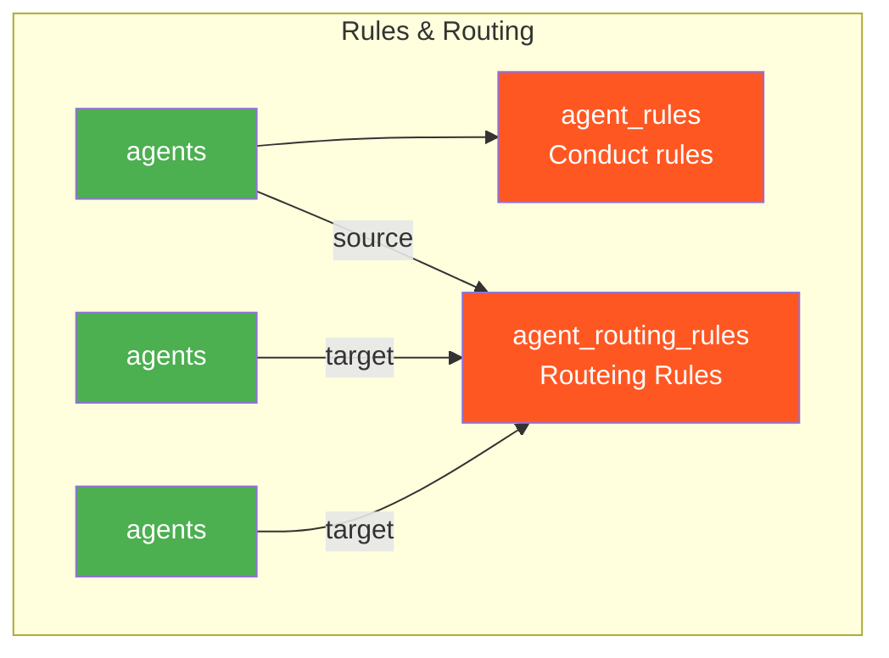
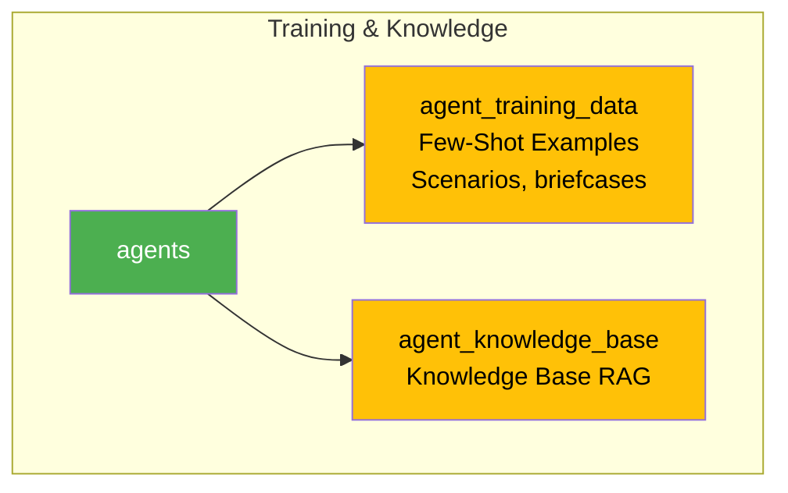
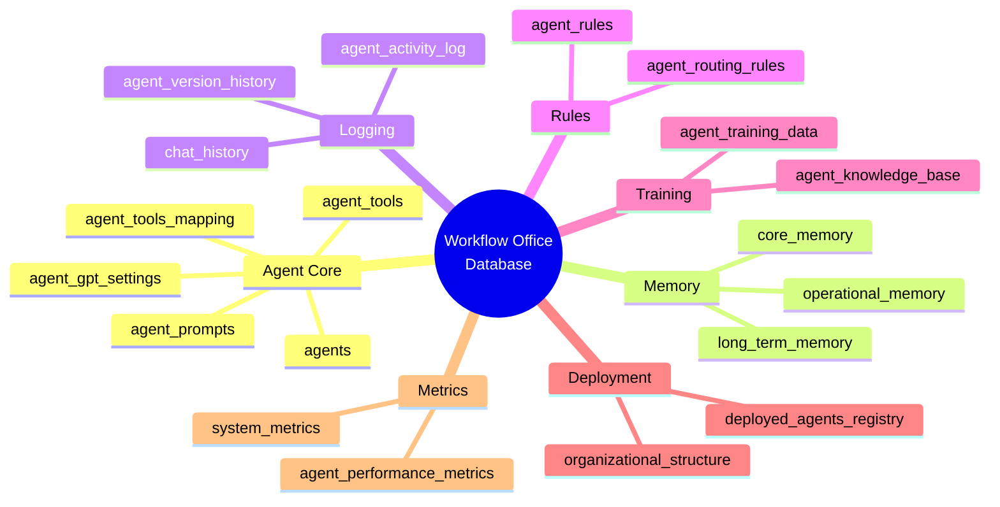

# 🗂️ Workflow Office - Database Figures

## 📊 Entity Relationship Diagram (ERD)

### Full database diagram

```mermaid
erDiagram
    %% ============================================
    % MAIN AGENCIES TABLES
    %% ============================================
    
    agents {
        VARCHAR agent_id PK "Unique ID Agent"
        VARCHAR agent_name "Indicated Name"
        VARCHAR agent_type Type Agent
        VARCHAR display_name Human Name
        VARCHAR roll "The Role of an Agent"
        TEXT persona "Description of identity"
        VARCHAR telegram_username UK "Telegram username"
        VARCHAR teams_identity UK "Teams identity"
        ENUM status "active/inactive/maintenance"
        VARCHAR version of "Clothes version"
        BOOLEAN is_active "Accident"
        TIMESTAMP created_at
        TIMESTAMP updated_at
        JSON Metadata "Metadata"
    }
    
    agent_prompts {
        VARCHAR prompt_id PK "ID Prompta"
        VARCHAR agent_id FK "ID Agent"
        TEXT system_prompt System Prompt
        TEXT tone_of_voice Telecommunications Tone
        VARCHAR version of "The Prompt Version"
        BOOLEAN is_current Current Version
        TEXT additional_instructions
        JSON examples "Few-Shot Examples"
        TIMESTAMP created_at
        TEXT changelog "Description of Changes"
    }
    
    agent_gpt_settings {
        VARCHAR setting_id PK "ID setup"
        VARCHAR agent_id FK UK "ID Agent"
        VARCHAR model "gpt-5-nano/gpt-5"
        ENUM reasoning_effort "minimal/low/medium/high"
        DECIMAL Timeline "Temperature for GPT-4)
        INTEGER max_tokens "Max Tokens"
        VARCHAR tool_choice "auto/required/none"
        BOOLEAN parallel_tool_calls
        BOOLEAN prompt_cache_enabled
        VARCHAR prompt_cache_key
        BOOLEAN use_responses_api
        INTEGER rate_limit_per_minute
    }
    
    agent_tools {
        VARCHAR tool_id PK "ID tool"
        VARCHAR tool_name UK "Name of Instrument"
        ENUM tool_type "function/mcp/api/database"
        TEXT declaration "Description for GPT"
        VARCHAR category "category"
        JSON parameters "JSON parameter diagram"
        VARCHAR mcp_server_url "URL MCP servers"
        VARCHAR api_endpoint "API endpoint"
        BOOLEAN is_active
    }
    
    agent_tools_mapping {
        VARCHAR mapping_id PK "ID communication"
        VARCHAR agent_id FK "ID Agent"
        VARCHAR tool_id FK "ID tool"
        BOOLEAN is_enabled "Is included"
        INTEGER priority
        INTEGER rate_limit_per_hour
        JSON custom_params
    }
    
    %% ============================================
    %% AGENT MEMORY
    %% ============================================
    
    core_memory {
        VARCHAR memory_id PK ID of memory recording"
        VARCHAR agent_id FK "ID Agent"
        ENUM memory_type "rule/fact/persona/constraint"
        VARCHAR memory_category
        VARCHAR memory_key Memory Key"
        TEXT memory_value "Purpose"
        INTEGER priority 1-10
        BOOLEAN is_permanent Permanent Memory"
        BOOLEAN is_active
        JSON applies_to_context
        JSON tags
    }
    
    operational_memory {
        VARCHAR operation_id PK "ID Operation"
        VARCHAR agent_id FK "ID Agent"
        VARCHAR session_id "ID Session"
        VARCHAR user_id "user ID"
        VARCHAR task_type "Truck Type"
        TEXT task_context Context
        TEXT current_focus Current Focus
        JSON session_data
        TIMESTAMP expires_at "TTL"
        TIMESTAMP created_at
    }
    
    long_term_memory {
        VARCHAR ltm_id PK "ID records"
        VARCHAR agent_id FK "ID Agent"
        ENUM memory_type "learned_pattern/user_preference"
        VARCHAR title
        TEXT content
        JSON context_tags
        INTEGER usage_count "Number of applications"
        DECIMAL success_rate "Purpose of Success"
        TIMESTAMP last_used_at
        BOOLEAN is_active
    }
    
    %% ============================================
    % HISTORY AND LOIGRATION
    %% ============================================
    
    chat_history {
        VARCHAR message_id PK "ID Message"
        VARCHAR agent_id FK "ID Agent"
        VARCHAR session_id "ID Session"
        VARCHAR user_id "user ID"
        ENUM role "user/assistant/system/tool"
        TEXT content
        ENUM content_type "text/image/tool_call"
        JSON tool_calls Tools Challenges
        ENUM platform "telegram/teams/slack"
        INTEGER tokens_used
        INTEGER response_time_ms
        TIMESTAMP timestamp
    }
    
    agent_activity_log {
        VARCHAR log_id PK "ID Loga"
        VARCHAR agent_id FK "ID Agent"
        ENUM activity_type "message/tool_call/error"
        VARCHAR activity_name
        TEXT description
        JSON details
        ENUM status "success/failure/partial"
        TEXT error_message
        INTEGER duration_ms
        TIMESTAMP timestamp
    }
    
    agent_version_history {
        VARCHAR history_id PK "ID History"
        VARCHAR agent_id FK "ID Agent"
        VARCHAR version "The Version"
        VARCHAR previous_version
        ENUM change_type "prompt/settings/tools"
        TEXT changelog
        JSON config_snapshot_before
        JSON config_snapshot_after
        VARCHAR changed_by
        BOOLEAN is_rollback
        TIMESTAMP changed_at
    }
    
    %% ============================================
    % RULE AND CONFIGURE
    %% ============================================
    
    agent_rules {
        VARCHAR rule_id PK "ID Rule"
        VARCHAR agent_id FK "ID Agent"
        ENUM rule_type "communication/behavior/security"
        VARCHAR rule_name
        TEXT rule_content
        JSON applies_when
        INTEGER priority
        BOOLEAN is_active
        BOOLEAN is_overridable
    }
    
    agent_routing_rules {
        VARCHAR routing_id PK "ID Rule"
        VARCHAR source_agent_id FK "Agent Source"
        VARCHAR target_agent_id FK "Recipient Agency"
        ENUM routing_type "delegation/escalation/report"
        TEXT routing_condition
        BOOLEAN is_bidirectional
        INTEGER priority
        BOOLEAN is_active
    }
    
    %% ============================================
    % LEARNING DATA
    %% ============================================
    
    agent_training_data {
        VARCHAR training_id PK "ID training data"
        VARCHAR agent_id FK "ID Agent"
        ENUM data_type "example/knowledge_base/faq"
        VARCHAR category
        VARCHAR title
        TEXT content
        TEXT input_example
        TEXT output_example
        JSON tags
        INTEGER priority
        BOOLEAN is_active
    }
    
    agent_knowledge_base {
        VARCHAR knowledge_id PK "ID Knowledge"
        VARCHAR agent_id FK "ID Agent (NULL for General)"
        VARCHAR title
        TEXT content
        VARCHAR source
        VARCHAR category
        JSON tags
        JSON embedding_vector "For RAG"
        INTEGER access_count
        TIMESTAMP last_accessed_at
        BOOLEAN is_active
        BOOLEAN is_verified
    }
    
    %% ============================================
    % ORGANIZATION AND DEPLOYMENT
    %% ============================================
    
    organizational_structure {
        VARCHAR id PK "ID records"
        VARCHAR department "Section"
        VARCHAR Division
        VARCHAR position "Duty"
        VARCHAR full_name "FIO"
        INTEGER hierarchy_level "Risk Level"
        VARCHAR manager_id FK "ID Manager"
        VARCHAR agent_id FK "ID Agent"
        ENUM employment_type "full_time/ai_agent"
        BOOLEAN is_active
    }
    
    deployed_agents_registry {
        VARCHAR deployment_id PK "ID deployment"
        VARCHAR agent_id FK "ID Agent"
        VARCHAR telegram_bot_token
        VARCHAR telegram_username UK
        VARCHAR teams_app_id
        VARCHAR teams_bot_id
        JSON channel_roles
        ENUM deployment_status "deployed/stopped/maintenance"
        TIMESTAMP last_health_check
        JSON limits
        JSON performance_metrics
        TIMESTAMP last_activity
    }
    
    %% ============================================
    % METRIC
    %% ============================================
    
    agent_performance_metrics {
        VARCHAR metric_id PK "ID metrics"
        VARCHAR agent_id FK "ID Agent"
        VARCHAR metric_name "Name of metrics"
        ENUM metric_type "counter/gauge/histogram"
        DECIMAL metric_value "Purpose"
        ENUM period "minute/hour/day/week/month"
        TIMESTAMP period_start
        TIMESTAMP period_end
        JSON dimensions
        TIMESTAMP recorded_at
    }
    
    system_metrics {
        VARCHAR id PK "ID metrics"
        VARCHAR metric_name
        DECIMAL metric_value
        VARCHAR agent_id FK "ID Agent (Operate)"
        VARCHAR period
        JSON metadata
        TIMESTAMP timestamp
    }
    
    %% ============================================
    % LINKS BETWEEN TABLES
    %% ============================================
    
    % Agent -> Prompts
    agents ♪ ♪ --o{ agent_prompts : "has prompts"
    
    % Agents -> GPT setup
    agents ~--~ agent_gpt_settings: "has settings"
    
    % Agent -> Tools (through Mapping)
    agents ♪ ♪ --o{ agent_tools_mapping :""
    agent_tools ♪ --o{ agent_tools_mapping : "available for"
    
    %% Actors – Memory
    --o{ core_memory : has core memory"
    --o{ operational_memory : has operational memory"
    --o{ long_term_memory : has long-term memory"
    
    % Agent - • History and logs
    agents ♪ --o{ chat_history : "has history"
    agents ♪ ♪ --o{ agent_activity_log : "has a log"
    agents ♪ ♪ --o{ agent_version_history :" has versions"
    
    % Agents -> Rules
    agents ♪ ♪ --o{ agent_rules : ♪ has rules ♪"
    agents ♪ ♪ --o{ agent_routing_rules : "passing from"
    agents ♪ --o{ agent_routing_rules : "tracking to"
    
    % Agents -> Training data
    agents \\--o{ agent_training_data : "is available for reference data"
    agents \\--o{ agent_knowledge_base : "has a knowledge base"
    
    % Agency -> Organization
    agents ||--o| organizational_structure : "submitted in accordance with"
    agents ♪ ♪ --o♪ deployed_agents_registry Original: ENGLISH"
    
    % Agent ->Metrics
    agents ♪ --o{ agent_performance_metrics : "has metrics"
    agents ||--o{ system_metrics : "related to"
    
    % of the organization ->self (hierarchy)
    organizational_structure ♪ --o{ organizational_structure :" Subjected to"
```

---

## 🎯 Architecture by group of tables

### 1. Agent Core Core)


### 2. Memory of the Agent (Memory of the Agent))


### 3. History and Logging)



### 4. Rules and router (Rules & Routing))



### 5. Training & Knowledge)



### 6. Deployment and metrics (Deployment & Metrics))


---

## 🔄 Agent's Life Cycle

```mermaid
flowchart TD
    Start([Establishment of Agent] -> Create [Box to Agents]
    
    Create --> Config {Configuration}
    Config --> Prompt [Addition propt<br/>agent_prompts]
    Config --> GPT[Installation GPT<br/>agent_gpt_settings]
    Config --> Tools [Mechanism link <br/>Zagent_tools_mapping]
    Config --> Memory[Initiating memory<br/>core_memory]
    
    Prompt --> Rules [Addition of rules <br/>agent_rules]
    GPT --> Rules
    Tools --> Rules
    Memory --> Rules
    
    Rules --> Routes [Construction of router <br/>agent_routing_rules]
    
    Runes --> Deploy [Deploy <br/>deployed_agents_registry]]
    
    Deploy --> Active {Agent &apos; s work}
    
    Active --> Chat [Message Processing <br/>chat_history]
    Active --> Activity[Logging activity<br/>agent_activity_log]
    Active --> OpMem[Operational memory<br/>operational_memory]
    Active -->Metrics[Metric collection<br/>Zagent_performance_metrics]
    
    Chat --> Learn [Learning <br/>long_term_memory]
    
    Active --> Update {Renewed?}
    Update -->|Yes.| Version[New version<br/>agent_version_history]
    Version --> Config
    Update -->\\\\Active
    
    Active --> Archive {archivation?}
    Archive --\\\\\Yes\ End([Status: archived]])
    Archive -- ♪ No ♪ Active ♪
    
    style Start fill:#4CAF50,color:#fff
    style Create fill:#2196F3,color:#fff
    style Active fill:#FF9800,color:#fff
    style End fill:#F44336,color:#fff
```

---

## 🌊 Data flow during request processing

```mermaid
sequenceDiagram
    participant U as User
    participant A as agents
    participant P as agent_prompts
    participant G as agent_gpt_settings
    participant T as agent_tools
    participant CM as core_memory
    participant OM as operational_memory
    participant CH as chat_history
    participant AL as agent_activity_log
    participant PM as agent_performance_metrics
    
    U->A: User &apos; s Request
    A->P: Loading Prompt
    A->G: Uploading of GPT settings
    A->>CM: Loading core memory
    A->OM: Loading the context of the session
    
    Note over A,G: Formation of GPT Request
    
    A->T: Checking accessible tools
    
    Note over A,T: GPT call with propt,<br/> memory and tools
    
    T-->A: Outcome tool calls
    A->AL: Logging tool calls
    
    A->CH: Retaining the message
    A->OM: Updating the context
    A->PM: Recording of metrics
    
    A-->U: Response to user
```

---

## 📦 Grouping of tables by purpose



---

## 🔗 Agents &apos; links (tracking))

```mermaid
graph TD
    subgraph "HR Team Routing"
        S[Supervisor<br/>@boss.ai]
        R[Recruiter<br/>@alena.ai]
        SC[Scrinner<br/>@sergei.ai]
        
        S -->delegation:<br/> search for candidates ~ R
        S -->delegation:<br/> screening _ SC
        R -->delegation:<br/> full-time screenings of SC
        R -->report:<br/> found candidates
        SC -->report:<br/> screening results
        SC -->report:<br/>it reports
    end
    
    style S fill:#4CAF50,color:#fff
    style R fill:#2196F3,color:#fff
    style SC fill:#FF9800,color:#fff
```

---

## 📊 Table statistics

| Category . Tables . . Main purpose |
|-----------|--------|---------------------|
| **Agent Core** ♪ 5 ♪ Basic information, prompts, settings, tools |
| **Memory*3 core, operational, long-term memory |
| **Logging** ♪ 3 ♪ Story of chat rooms, activity logs, versions |
| **Rules** 2 : Rules of conduct and routement |
*Training** * 2 * Training data and knowledge base *
| **Deployment** ♪ 2 ♪ Organizational structure and deployment roster |
| **Metrics** 2 * Performance metrics and systems |
| **TOTAL***********19****** Full agent ecosystem |

---

## 🎨 Color legend

- 🟢 **Green** - Basic Agent Tables (agents))
- 🔵 **Blue** - configuration (prompts, settings, tools))
- 🟣 **Core, operational, long-term memory)
- 🔷 **Blue** - Logging (history, logs, versions))
- 🔴 **Red** - Rules)
- 🟡 **Yellow** - Training (training, knowledge))
- 🟤 **Brown** - Deployment (org, registration))
- ⚫ **Grey**-Metrics (performance, system))

---

## 🚀 Benefits of architecture

### ✅ Normalization
- No duplication of data
- Easily updated components
- Integrity through external keys

### ✅ Scale
- Independent storage of components
- Horizontal scale
- Optimized indices

### ✅ Flexible
- JSON Castomization Fields
- Modular architecture
- The configuration version

### ✅ Productivity
- Indexes on all FK and frequently used fields
- Submissions (views) for frequent queries
- TTL for auto-cleaning of temporary data

---

**Audience:** Workflow Office Team  
** Version:** 2.0.0  
**Date:** 2025-10-13

