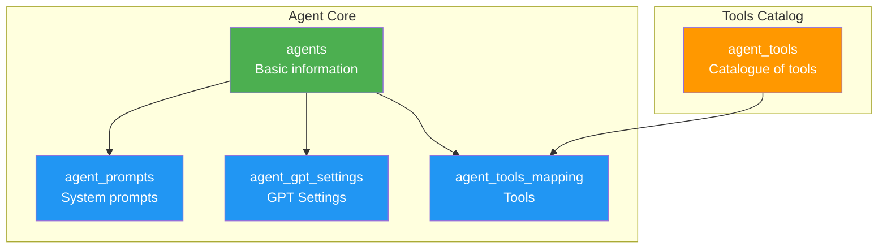
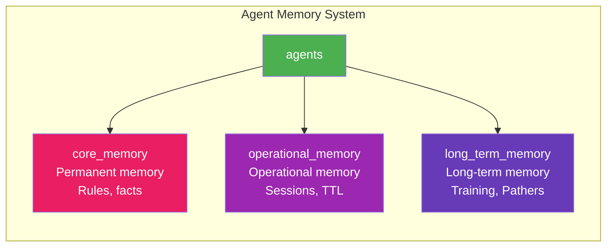
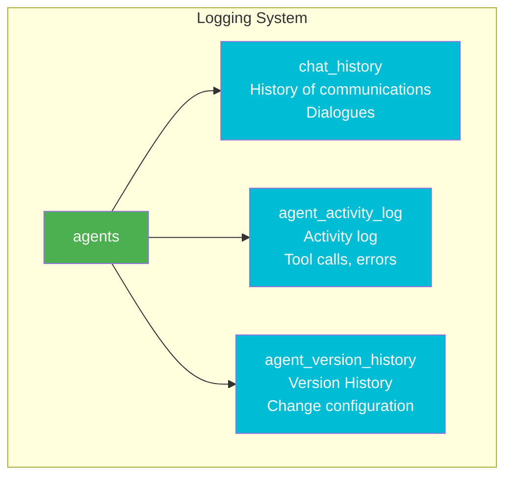
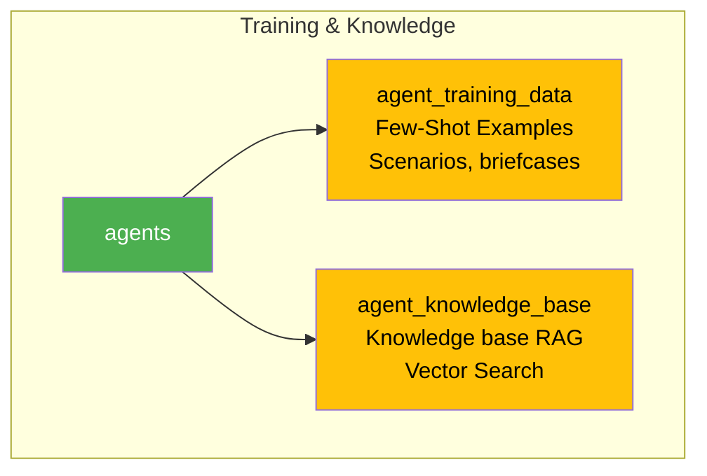
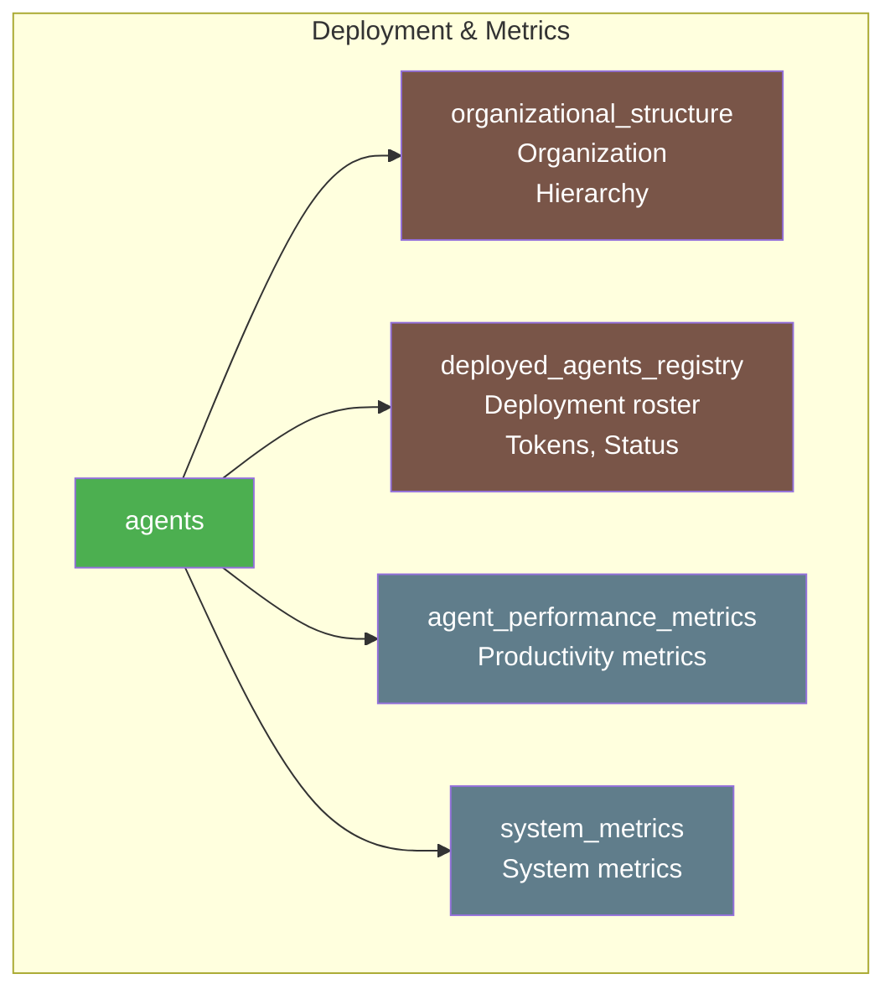
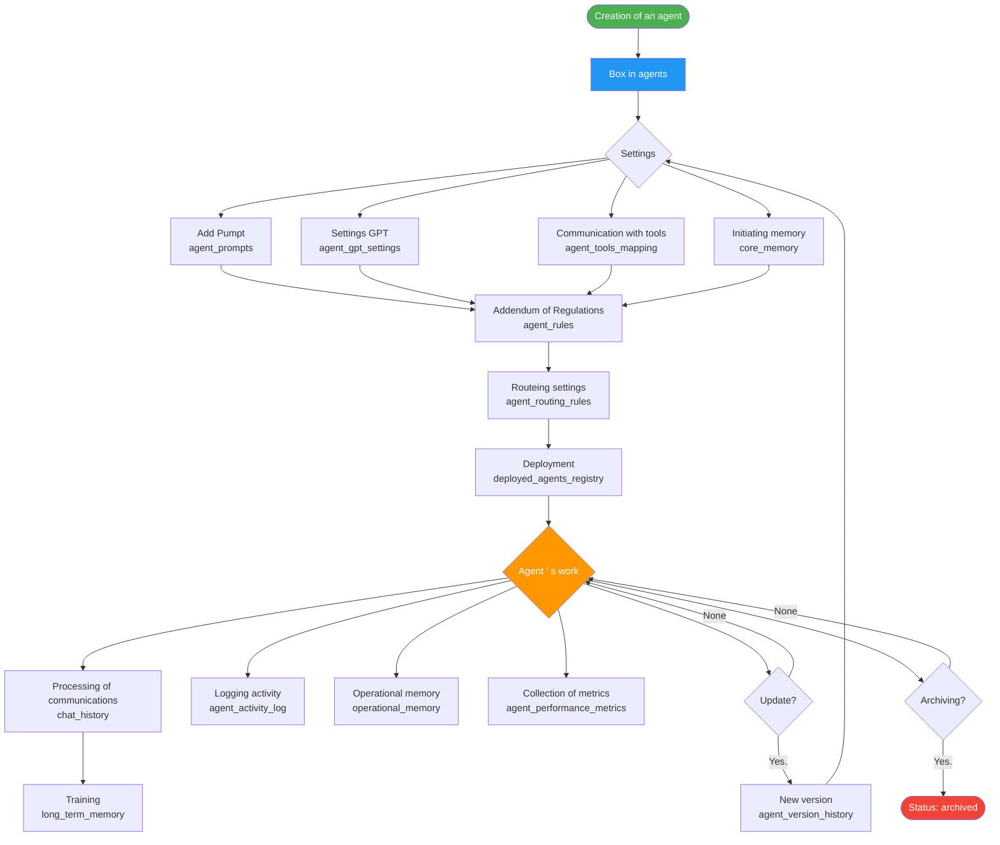
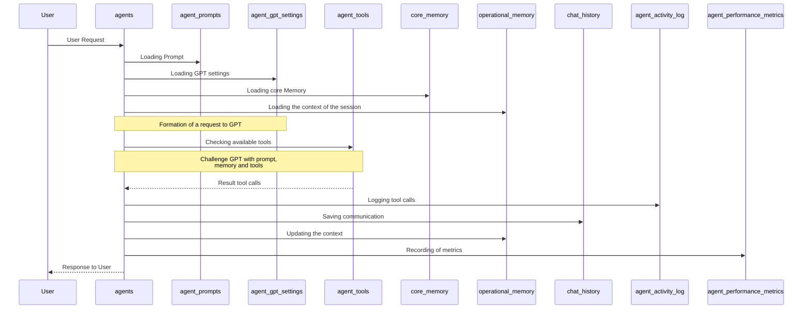
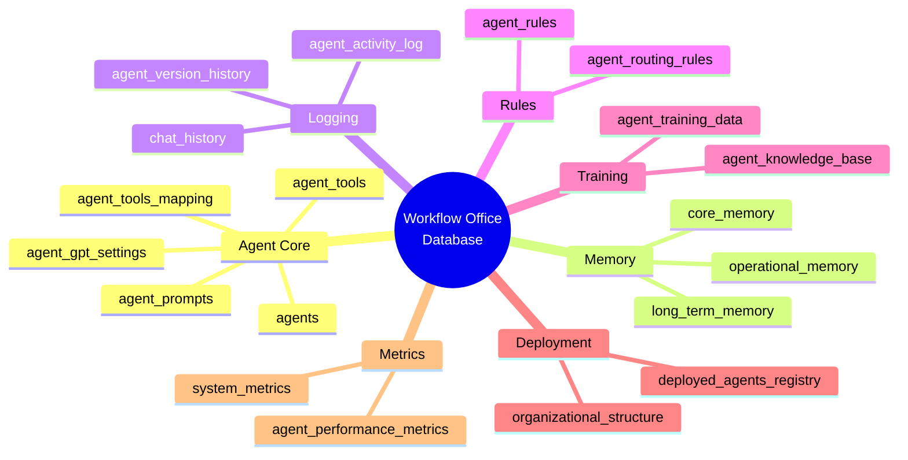

# 🗂️ Workflow Office - Database Figures

## 📊 Entity Relationship Diagram (ERD)

### Full database diagram

```mermaid
erDiagram
    %% ============================================
    %% MAIN TABLES OF AGENCIES
    %% ============================================
    
    agents {
        VARCHAR agent_id PK "Unique ID agent"
        VARCHAR agent_name "Identified Name"
        VARCHAR agent_type "Type of agent"
        VARCHAR display_name "Human name"
        VARCHAR role "The role of the agent"
        TEXT persona "Identity description"
        VARCHAR telegram_username UK "Telegram username"
        VARCHAR teams_identity UK "Teams identity"
        ENUM status "active/inactive/maintenance"
        VARCHAR version "The configuration version"
        BOOLEAN is_active "Activated"
        TIMESTAMP created_at
        TIMESTAMP updated_at
        JSON metadata "Metadata"
    }
    
    agent_prompts {
        VARCHAR prompt_id PK "ID Prompta"
        VARCHAR agent_id FK "ID agent"
        TEXT system_prompt "System Prompte"
        TEXT tone_of_voice "Tone of communication"
        VARCHAR version "Prompt version"
        BOOLEAN is_current "Current version"
        TEXT additional_instructions
        JSON examples "Few-Shot Examples"
        TIMESTAMP created_at
        TEXT changelog "Description of changes"
    }
    
    agent_gpt_settings {
        VARCHAR setting_id PK "ID Settings"
        VARCHAR agent_id FK UK "ID agent"
        VARCHAR model "gpt-5-nano/gpt-5"
        ENUM reasoning_effort "minimal/low/medium/high"
        DECIMAL temperature "Temperature for GPT-4"
        INTEGER max_tokens "Max Tokenov"
        VARCHAR tool_choice "auto/required/none"
        BOOLEAN parallel_tool_calls
        BOOLEAN prompt_cache_enabled
        VARCHAR prompt_cache_key
        BOOLEAN use_responses_api
        INTEGER rate_limit_per_minute
    }
    
    agent_tools {
        VARCHAR tool_id PK "ID instrument"
        VARCHAR tool_name UK "Title of tool"
        ENUM tool_type "function/mcp/api/database"
        TEXT description "Description for GPT"
        VARCHAR category "Category"
        JSON parameters "JSON parameter diagram"
        VARCHAR mcp_server_url "URL MCP servers"
        VARCHAR api_endpoint "API endpoint"
        BOOLEAN is_active
    }
    
    agent_tools_mapping {
        VARCHAR mapping_id PK "ID Communications"
        VARCHAR agent_id FK "ID agent"
        VARCHAR tool_id FK "ID instrument"
        BOOLEAN is_enabled "Whether included"
        INTEGER priority "Priority (0-Higher)"
        INTEGER rate_limit_per_hour
        JSON custom_params
    }
    
    %% ============================================
    %% AGENT MEMORY
    %% ============================================
    
    core_memory {
        VARCHAR memory_id PK "ID Memory records"
        VARCHAR agent_id FK "ID agent"
        ENUM memory_type "rule/fact/persona/constraint"
        VARCHAR memory_category
        VARCHAR memory_key "The Key to Memory"
        TEXT memory_value "Value"
        INTEGER priority "Priority 1-10"
        BOOLEAN is_permanent "Permanent memory"
        BOOLEAN is_active
        JSON applies_to_context
        JSON tags
    }
    
    operational_memory {
        VARCHAR operation_id PK "ID Operations"
        VARCHAR agent_id FK "ID agent"
        VARCHAR session_id "ID session"
        VARCHAR user_id "ID User"
        VARCHAR task_type "Type of task"
        TEXT task_context "Context"
        TEXT current_focus "Current Focus"
        JSON session_data
        TIMESTAMP expires_at "TTL"
        TIMESTAMP created_at
    }
    
    long_term_memory {
        VARCHAR ltm_id PK "ID Records"
        VARCHAR agent_id FK "ID agent"
        ENUM memory_type "learned_pattern/user_preference"
        VARCHAR title
        TEXT content
        JSON context_tags
        INTEGER usage_count "Number of applications"
        DECIMAL success_rate "Percentage of success"
        TIMESTAMP last_used_at
        BOOLEAN is_active
    }
    
    %% ============================================
    %% BACKGROUND AND LOIGRATION
    %% ============================================
    
    chat_history {
        VARCHAR message_id PK "ID Communications"
        VARCHAR agent_id FK "ID agent"
        VARCHAR session_id "ID session"
        VARCHAR user_id "ID User"
        ENUM role "user/assistant/system/tool"
        TEXT content "Content"
        ENUM content_type "text/image/tool_call"
        JSON tool_calls "Challenges to tools"
        ENUM platform "telegram/teams/slack"
        INTEGER tokens_used
        INTEGER response_time_ms
        TIMESTAMP timestamp
    }
    
    agent_activity_log {
        VARCHAR log_id PK "ID Loga"
        VARCHAR agent_id FK "ID agent"
        ENUM activity_type "message/tool_call/error"
        VARCHAR activity_name
        TEXT description
        JSON details
        ENUM status "success/failure/partial"
        TEXT error_message
        INTEGER duration_ms
        TIMESTAMP timestamp
    }
    
    agent_version_history {
        VARCHAR history_id PK "ID History"
        VARCHAR agent_id FK "ID agent"
        VARCHAR version "Version"
        VARCHAR previous_version
        ENUM change_type "prompt/settings/tools"
        TEXT changelog
        JSON config_snapshot_before
        JSON config_snapshot_after
        VARCHAR changed_by
        BOOLEAN is_rollback
        TIMESTAMP changed_at
    }
    
    %% ============================================
    %% RULES AND CONFIGURES
    %% ============================================
    
    agent_rules {
        VARCHAR rule_id PK "ID Rules"
        VARCHAR agent_id FK "ID agent"
        ENUM rule_type "communication/behavior/security"
        VARCHAR rule_name
        TEXT rule_content
        JSON applies_when
        INTEGER priority
        BOOLEAN is_active
        BOOLEAN is_overridable
    }
    
    agent_routing_rules {
        VARCHAR routing_id PK "ID Rules"
        VARCHAR source_agent_id FK "Agent Source"
        VARCHAR target_agent_id FK "Recipient Agent"
        ENUM routing_type "delegation/escalation/report"
        TEXT routing_condition
        BOOLEAN is_bidirectional
        INTEGER priority
        BOOLEAN is_active
    }
    
    %% ============================================
    %% DATA TRAINING
    %% ============================================
    
    agent_training_data {
        VARCHAR training_id PK "ID training data"
        VARCHAR agent_id FK "ID agent"
        ENUM data_type "example/knowledge_base/faq"
        VARCHAR category
        VARCHAR title
        TEXT content
        TEXT input_example
        TEXT output_example
        JSON tags
        INTEGER priority
        BOOLEAN is_active
    }
    
    agent_knowledge_base {
        VARCHAR knowledge_id PK "ID knowledge"
        VARCHAR agent_id FK "ID agent (NULL for general)"
        VARCHAR title
        TEXT content
        VARCHAR source
        VARCHAR category
        JSON tags
        JSON embedding_vector "For RAG"
        INTEGER access_count
        TIMESTAMP last_accessed_at
        BOOLEAN is_active
        BOOLEAN is_verified
    }
    
    %% ============================================
    %% ORGANIZATION AND DEPLOYMENT
    %% ============================================
    
    organizational_structure {
        VARCHAR id PK "ID Records"
        VARCHAR department "Division"
        VARCHAR division "Unit"
        VARCHAR position "Post"
        VARCHAR full_name "FIO"
        INTEGER hierarchy_level "Level of hierarchy"
        VARCHAR manager_id FK "ID Manager"
        VARCHAR agent_id FK "ID agent"
        ENUM employment_type "full_time/ai_agent"
        BOOLEAN is_active
    }
    
    deployed_agents_registry {
        VARCHAR deployment_id PK "ID deployment"
        VARCHAR agent_id FK "ID agent"
        VARCHAR telegram_bot_token
        VARCHAR telegram_username UK
        VARCHAR teams_app_id
        VARCHAR teams_bot_id
        JSON channel_roles
        ENUM deployment_status "deployed/stopped/maintenance"
        TIMESTAMP last_health_check
        JSON limits
        JSON performance_metrics
        TIMESTAMP last_activity
    }
    
    %% ============================================
    %% METRICS
    %% ============================================
    
    agent_performance_metrics {
        VARCHAR metric_id PK "ID metrics"
        VARCHAR agent_id FK "ID agent"
        VARCHAR metric_name "The name of the metrics"
        ENUM metric_type "counter/gauge/histogram"
        DECIMAL metric_value "Value"
        ENUM period "minute/hour/day/week/month"
        TIMESTAMP period_start
        TIMESTAMP period_end
        JSON dimensions
        TIMESTAMP recorded_at
    }
    
    system_metrics {
        VARCHAR id PK "ID metrics"
        VARCHAR metric_name
        DECIMAL metric_value
        VARCHAR agent_id FK "ID agent (optional)"
        VARCHAR period
        JSON metadata
        TIMESTAMP timestamp
    }
    
    %% ============================================
    %% LINKS BETWEEN TABLES
    %% ============================================
    
    %% Agents -> Prompts
    agents ||--o{ agent_prompts : "has prompts"
    
    %% Agents -> GPT Settings
    agents ||--|| agent_gpt_settings : "has settings"
    
    %% Agents -> Tools (Through mapping)
    agents ||--o{ agent_tools_mapping : "uses"
    agent_tools ||--o{ agent_tools_mapping : "available for"
    
    %% Agents -> Memory
    agents ||--o{ core_memory : "has core memory"
    agents ||--o{ operational_memory : "has operational memory"
    agents ||--o{ long_term_memory : "has long-term memory"
    
    %% Agents -> History and logs
    agents ||--o{ chat_history : "has history"
    agents ||--o{ agent_activity_log : "has logs"
    agents ||--o{ agent_version_history : "has versions"
    
    %% Agents -> Rules
    agents ||--o{ agent_rules : "has rules"
    agents ||--o{ agent_routing_rules : "routed from"
    agents ||--o{ agent_routing_rules : "routed to"
    
    %% Agents -> Training data
    agents ||--o{ agent_training_data : "has training data"
    agents ||--o{ agent_knowledge_base : "has a knowledge base"
    
    %% Agents -> Organization
    agents ||--o| organizational_structure : "submitted in accordance with"
    agents ||--o| deployed_agents_registry : "deployed as"
    
    %% Agents -> Meterics
    agents ||--o{ agent_performance_metrics : "has metrics"
    agents ||--o{ system_metrics : "related to"
    
    %% Organization -> Youre your own man (hierarchy)
    organizational_structure ||--o{ organizational_structure : "Obedience"
```

---

## 🎯 Architecture by group of tables

### 1. Agent Core Core)



### 2. Memory of the Agent (Memory of the Agent))



### 3. History and Logging)



### 4. Rules and router (Rules & Routing))


### 5. Training & Knowledge)



### 6. Deployment and metrics (Deployment & Metrics))



---

## 🔄 Agent's Life Cycle



---

## 🌊 Data flow during request processing



---

## 📦 Grouping of tables by purpose



---

## 🔗 Agents &apos; links (tracking))

```mermaid
graph TD
    subgraph "HR Team Routing"
        S[Supervisor<br/>@boss.ai]
        R[Recruiter<br/>@alena.ai]
        SC[Scrinner<br/>@sergei.ai]
        
        S -->|delegation:<br/>Search for candidates| R
        S -->|delegation:<br/>screening| SC
        R -->|delegation:<br/>Detailed screening| SC
        R -->|report:<br/>Candidates found| S
        SC -->|report:<br/>Results of screening| R
        SC -->|report:<br/>Final reports| S
    end
    
    style S fill:#4CAF50,color:#fff
    style R fill:#2196F3,color:#fff
    style SC fill:#FF9800,color:#fff
```

---

## 📊 Table statistics

| Category | Tables | Main function |
|-----------|--------|---------------------|
| **Agent Core** | 5 | Basic information, prompts, settings, tools |
| **Memory** | 3 | Core, Operational, Long-term memory |
| **Logging** | 3 | chat history, activity logs, versions |
| **Rules** | 2 | Rules of conduct and routeting |
| **Training** | 2 | Training data and knowledge base |
| **Deployment** | 2 | Structure and deployment roster |
| **Metrics** | 2 | Productivity metrics and systems |
| **TOTAL** | **19** | Full agent ecosystem |

---

## 🎨 Color legend

- 🟢 **Green** - Basic Agent Tables (agents))
- 🔵 **Blue** - configuration (prompts, settings, tools))
- 🟣 **Core, operational, long-term memory)
- 🔷 **Blue** - Logging (history, logs, versions))
- 🔴 **Red** - Rules)
- 🟡 **Yellow** - Training (training, knowledge))
- 🟤 **Brown** - Deployment (org, registration))
- ⚫ **Grey**-Metrics (performance, system))

---

## 🚀 Benefits of architecture

### ✅ Normalization
- No duplication of data
- Easily updated components
- Integrity through external keys

### ✅ Scale
- Independent storage of components
- Horizontal scale
- Optimized indices

### ✅ Flexible
- JSON Castomization Fields
- Modular architecture
- The configuration version

### ✅ Productivity
- Indexes on all FK and frequently used fields
- Submissions (views) for frequent queries
- TTL for auto-cleaning of temporary data

---

**Audience:** Workflow Office Team  
** Version:** 2.0.0  
**Date:** 2025-10-13

