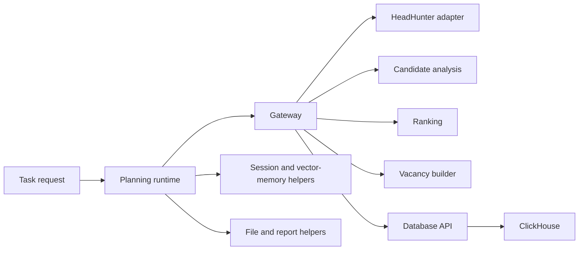

# Recruitment Workflow Runtime

A task-oriented recruitment runtime with planning/orchestration modules, specialist analysis, candidate ranking, vacancy adapters, memory helpers and ClickHouse persistence. This component sits alongside the separate candidate-ranking application and shared office services in the [repository overview](../../README.md).

The intended workflow connects a vacancy request, authorized response collection, candidate analysis, ranked results and reports. The source exposes those integration boundaries; a complete autonomous recruitment cycle and measurable hiring improvement are not established by the included offline checks.

## Architecture and service responsibilities



| Service | Configured host port | Entry point |
| --- | --- | --- |
| Recruitment runtime | 8010 | `autorecruiter/main.py` |
| Coordinator | 8020 | `master_agent/main.py` |
| Gateway | 8088 | `gateway/main.py` |
| Ranking | 8002 | `ranking/main.py` |
| HeadHunter adapter | 8003 | `hh_api/main.py` |
| Configuration | 8004 | `config/main.py` |
| Analysis | 8005 | `ai_analysis/main.py` |
| Database API | 8006 | `database/main.py` |
| Vacancy builder | 8008 | `vacancy_builder/main.py` |
| ClickHouse | 8123 HTTP; 9000 native | Compose service |

The Compose stacks for this component and `candidate_ranking` overlap in ports. Use separate deployments or an explicit integration configuration. The consolidated repository does not claim that every component can be started together unchanged.

## Planning, tools and memory

The `autorecruiter` package includes task models, the planning runtime, memory management, web-search helpers, file/report handling and a code-execution module. Planning state and a reported completion message must be distinguished from an actual downstream action: a vacancy is published only when the authorized source adapter confirms it, and a report exists only when the file operation succeeds.

Memory modules separate immediate task context from vector-backed retrieval. Retaining a memory or producing a retrospective summary is not model fine-tuning or demonstrated self-improvement. Tool execution and code execution need an application-level permission boundary; this repository does not claim a hardened sandbox merely because execution is wrapped in a helper class.

Candidate analysis includes specialist prompts and coordinator aggregation. The ranking service consumes existing scores. This is applied AI orchestration, not a separately trained ranking model or the RL module published in `feedback-policy-learning`.

## Configuration

From the repository root, prepare missing ignored configuration copies:

```bash
python scripts/prepare_config.py
```

Review this component's `config/settings.example.yaml`, provider settings and `.env.example`. Supply authorized provider credentials and HeadHunter OAuth details locally. No working API credentials are distributed. A provider model name or optional generation setting in an older example is a configurable integration choice, not a guarantee of current account access or SDK support.

The runtime includes configurable iteration/time limits. Validate the actual limits and stop conditions in the task model before using live tools. Configuration changes should be kept alongside the run manifest so that a report can be traced to the prompts, provider model, tool permissions and dataset used.

## Optional live deployment

From this component directory:

```bash
docker compose config --quiet
docker compose up -d --build
docker compose ps
curl --fail http://localhost:8010/health
curl --fail http://localhost:8088/health
curl --fail http://localhost:8005/health
```

This workflow starts the configured services; it is separate from the synthetic offline replay. Live vacancy creation, messaging and account operations require the operator's explicit authorization. No such operations are executed by the repository's offline checks.

For local Python development, create a separate environment and use this component's requirements. Do not combine all component requirements into the root minimal-check environment.

```bash
python -m venv .venv
.venv/bin/python -m pip install -r requirements.txt
```

The Windows interpreter path is `./.venv/Scripts/python.exe`. Compose remains the reference for per-service commands, volumes and host ports.

## Diagnostics

```bash
docker compose logs --tail=100 recruitment_runtime
docker compose logs --tail=100 gateway hh_api
docker compose logs --tail=100 ai_analysis ranking database
docker compose ps
```

Separate provider authentication failures, quota/rate limits, missing dependencies, occupied ports and unavailable downstream services. For a task that does not terminate, inspect its iteration limit, tool results and persisted status. An unconstrained goal, an unreachable adapter or repeatedly rejected action should not be reported as successful automation.

Do not print API keys to test configuration. Logs and reports should contain synthetic candidate records during demonstrations. Original account-debug exports, private resume files and tenant-specific URLs are excluded.

## Offline verification and evaluation

The root demo and offline suite validate shared candidate/ranking contracts using fictional records. They do not run an actual planning cycle, invoke provider models, publish a vacancy, retrieve real applicants or establish the reliability of long-term memory.

```bash
.venv/bin/python offline_demo.py
.venv/bin/python -m unittest discover -s tests/offline -v
```

A full workflow study needs a controlled adapter environment, explicit allowed actions, persisted event traces and checks for replay/idempotency, retries and termination. Track confirmed tool actions rather than generated action descriptions. Evaluate candidate extraction/ranking separately with independent labels and suitable baselines.

The previous guide's examples of a completed eight-iteration run, candidate counts, execution time, token prices, cost savings and autonomous improvement were illustrations or unverified claims. They are not published as measured outcomes. Actual cost and latency must be recorded for the configured provider and task.

## Extension points and remaining work

The code is organized for changes to task schemas, provider adapters, specialist prompts, memory retrieval and report generation. Potential extensions include additional source adapters, controlled messaging integrations, more explicit approval flows and richer evaluation datasets. These are development directions, not a claim that every connector, notification channel or predictive model is implemented.

See `docs/AUTOGPT_USAGE.md`, `QUICK_START.md` and `INSTALL.md` where present for implementation-specific notes. Read these together with the current configuration and route index below. Customer-specific support addresses and internal repository URLs have been removed; portfolio contact is through the GitHub account.

## Implemented HTTP route index

Declared constant paths are listed from the source; dynamic gateway forwarding remains defined in the associated handler.

| Source | Method | Declared route | Handler |
| --- | --- | --- | --- |
| `ai_analysis/main.py` | GET | `/health` | `health_check` |
| `ai_analysis/main.py` | POST | `/analyze` | `analyze_candidate` |
| `ai_analysis/main.py` | POST | `/analyze/batch` | `analyze_candidates_batch` |
| `ai_analysis/main.py` | GET | `/config` | `get_ai_config` |
| `ai_analysis/main.py` | POST | `/settings/auth` | `update_auth_settings` |
| `ai_analysis/main.py` | POST | `/multi-agent/analyze` | `analyze_candidate_multi_agent` |
| `ai_analysis/main.py` | GET | `/multi-agent/agents` | `get_available_agents` |
| `ai_analysis/main.py` | GET | `/multi-agent/health` | `multi_agent_health_check` |
| `ai_analysis/main.py` | POST | `/multi-agent/batch` | `analyze_candidates_batch_multi_agent` |
| `autorecruiter/main.py` | GET | `/health` | `health_check` |
| `autorecruiter/main.py` | POST | `/api/autorecruiter/tasks` | `create_autorecruiter_task` |
| `autorecruiter/main.py` | GET | `/api/autorecruiter/tasks/{task_id}/status` | `get_autorecruiter_task_status` |
| `autorecruiter/main.py` | GET | `/api/autorecruiter/tasks/{task_id}/result` | `get_autorecruiter_task_result` |
| `config/main.py` | GET | `/health` | `health_check` |
| `config/main.py` | GET | `/config` | `get_config` |
| `config/main.py` | GET | `/config/{section}` | `get_config_section` |
| `config/main.py` | PUT | `/config/{section}` | `update_config_section` |
| `config/main.py` | GET | `/services` | `get_services_config` |
| `config/main.py` | GET | `/services/{service_name}` | `get_service_config` |
| `config/main.py` | GET | `/hh-api` | `get_hh_api_config` |
| `database/main.py` | GET | `/health` | `health_check` |
| `database/main.py` | POST | `/candidates` | `save_candidate` |
| `database/main.py` | GET | `/candidates/{candidate_id}` | `get_candidate` |
| `database/main.py` | POST | `/candidates/search` | `search_candidates` |
| `database/main.py` | GET | `/candidates/top/{limit}` | `get_top_candidates` |
| `database/main.py` | PUT | `/candidates/{candidate_id}/search` | `update_search_count` |
| `database/main.py` | GET | `/statistics` | `get_statistics` |
| `gateway/main.py` | GET | `/ping` | `ping` |
| `gateway/main.py` | GET | `/health` | `health_check` |
| `gateway/main.py` | GET | `/health/services` | `get_services_health` |
| `gateway/main.py` | GET | `/config` | `get_config` |
| `gateway/main.py` | GET | `/config/{section}` | `get_config_section` |
| `gateway/main.py` | GET | `/filters` | `get_search_filters` |
| `gateway/main.py` | GET | `/search` | `search_candidates` |
| `gateway/main.py` | GET | `/candidates/{candidate_id}` | `get_candidate_details` |
| `gateway/main.py` | POST | `/top-candidates` | `get_top_candidates` |
| `gateway/main.py` | GET | `/areas` | `get_areas` |
| `gateway/main.py` | GET | `/professional-roles` | `get_professional_roles` |
| `gateway/main.py` | GET | `/languages` | `get_languages` |
| `gateway/main.py` | GET | `/dictionaries` | `get_dictionaries` |
| `gateway/main.py` | GET | `/hh-api/me` | `get_current_user` |
| `gateway/main.py` | GET | `/hh-api/employer/managers` | `get_employer_managers` |
| `gateway/main.py` | GET | `/oauth/authorize-url` | `get_authorize_url` |
| `gateway/main.py` | POST | `/oauth/token` | `exchange_code_for_token` |
| `gateway/main.py` | POST | `/oauth/refresh` | `refresh_token` |
| `gateway/main.py` | POST | `/settings/auth` | `update_auth_settings` |
| `gateway/main.py` | GET | `/ranking/weights` | `get_ranking_weights` |
| `gateway/main.py` | PUT | `/ranking/weights` | `update_ranking_weights` |
| `gateway/main.py` | GET | `/database/statistics` | `get_database_statistics` |
| `gateway/main.py` | POST | `/database/candidates` | `create_candidate` |
| `gateway/main.py` | GET | `/database/candidates/{candidate_id}` | `get_candidate_from_db` |
| `gateway/main.py` | PUT | `/database/candidates/{candidate_id}/searched` | `update_candidate_search_count` |
| `gateway/main.py` | POST | `/ranking/calculate-scores` | `calculate_scores` |
| `gateway/main.py` | POST | `/vacancy/top` | `build_vacancy_top` |
| `gateway/main.py` | POST | `/vacancy/responses` | `vacancy_responses` |
| `gateway/main.py` | POST | `/vacancy/details` | `vacancy_details` |
| `gateway/main.py` | POST | `/config/save` | `save_config` |
| `gateway/main.py` | GET | `/vacancy-builder/areas` | `get_vacancy_areas` |
| `gateway/main.py` | GET | `/vacancy-builder/professional-roles` | `get_vacancy_professional_roles` |
| `gateway/main.py` | GET | `/vacancy-builder/templates` | `get_vacancy_templates` |
| `gateway/main.py` | GET | `/vacancy-builder/templates/{template_id}` | `get_vacancy_template` |
| `gateway/main.py` | POST | `/vacancy-builder/validate` | `validate_vacancy_draft` |
| `gateway/main.py` | POST | `/vacancy-builder/create` | `create_vacancy` |
| `hh_api/main.py` | GET | `/health` | `health_check` |
| `hh_api/main.py` | GET | `/areas` | `get_areas` |
| `hh_api/main.py` | GET | `/professional-roles` | `get_professional_roles` |
| `hh_api/main.py` | GET | `/languages` | `get_languages` |
| `hh_api/main.py` | GET | `/dictionaries` | `get_dictionaries` |
| `hh_api/main.py` | POST | `/vacancy/details` | `get_vacancy_details_endpoint` |
| `hh_api/main.py` | POST | `/vacancy/responses` | `get_vacancy_responses_endpoint` |
| `hh_api/main.py` | GET | `/search` | `search_resumes` |
| `hh_api/main.py` | GET | `/resume/{resume_id}` | `get_resume_details` |
| `hh_api/main.py` | GET | `/oauth/authorize-url` | `get_authorize_url` |
| `hh_api/main.py` | POST | `/oauth/token` | `exchange_code_for_token` |
| `hh_api/main.py` | POST | `/oauth/refresh` | `refresh_token` |
| `hh_api/main.py` | POST | `/settings/auth` | `update_auth_settings` |
| `hh_api/main.py` | POST | `/employer/vacancies` | `create_vacancy` |
| `hh_api/main.py` | GET | `/me` | `get_current_user` |
| `hh_api/main.py` | GET | `/employer/managers` | `get_employer_managers` |
| `hh_api/main.py` | GET | `/employer/vacancies` | `get_employer_vacancies` |
| `ranking/main.py` | GET | `/health` | `health_check` |
| `ranking/main.py` | POST | `/rank` | `rank_candidates` |
| `ranking/main.py` | GET | `/weights` | `get_weights` |
| `ranking/main.py` | PUT | `/weights` | `update_weights` |
| `ranking/main.py` | POST | `/calculate-scores` | `calculate_scores` |
| `vacancy_builder/main.py` | GET | `/health` | `health_check` |
| `vacancy_builder/main.py` | GET | `/areas` | `get_areas` |
| `vacancy_builder/main.py` | GET | `/professional-roles` | `get_professional_roles` |
| `vacancy_builder/main.py` | GET | `/templates` | `get_templates` |
| `vacancy_builder/main.py` | GET | `/templates/{template_id}` | `get_template` |
| `vacancy_builder/main.py` | POST | `/create` | `create_vacancy` |
| `vacancy_builder/main.py` | POST | `/validate` | `validate_vacancy` |
